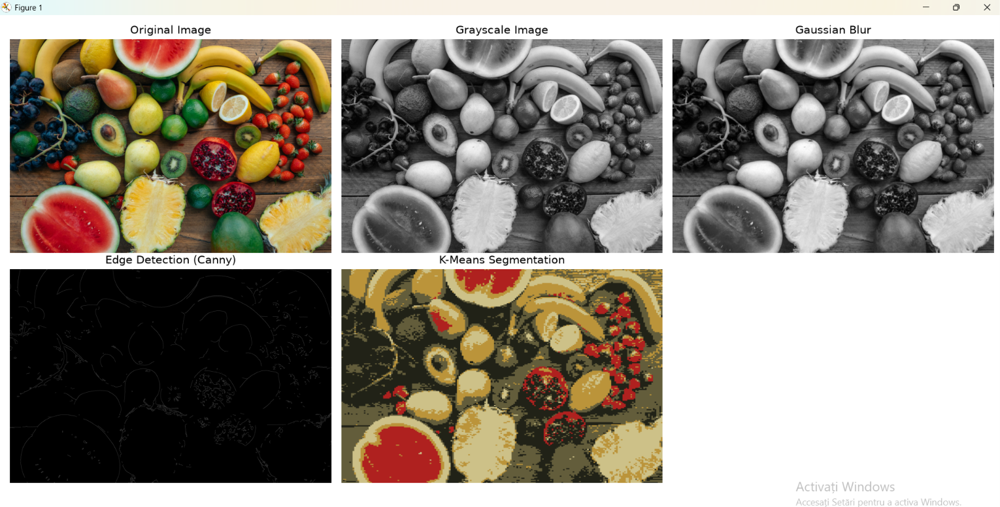

# Vision-Craft

Vision-Craft is a Python image processing project built with OpenCV, NumPy and Matplotlib. It implements several fundamental image processing techniques and visualizes their results.



## Features

- **Image Loading** – Load images using OpenCV.
- **Grayscale Conversion** – Convert RGB images to grayscale.
- **Gaussian Blur** – Reduce image noise through Gaussian filtering.
- **Edge Detection** – Detect edges using the Canny algorithm.
- **Image Segmentation** – Group pixels into color clusters using K-Means.

## Technologies

- Python
- OpenCV
- NumPy
- Matplotlib

## Project Structure

```text
vision-craft/
│
├── examples/
│   └── results.png
|
├── images/
│   └── test.jpg
|
├── venv/
├── .gitignore
├── image_processing.py
├── main.py
├── README.md
└── requirements.txt
```

## Installation

Clone the repository:

```bash
git clone <repository-url>
cd vision-craft
```

Create and activate a virtual environment:

```bash
python -m venv venv
```

On Windows PowerShell:

```powershell
.\venv\Scripts\Activate.ps1
```

Install the required dependencies:

```bash
pip install -r requirements.txt
```

## Usage

Run the application:

```bash
python main.py
```

The application processes the input image and displays the original image alongside the processing results.

## Examples

The `examples/` directory contains a visual example of the processing results.

## Image Processing Techniques

| Technique | Description |
|---|---|
| Grayscale Conversion | Converts an image into shades of gray. |
| Gaussian Blur | Smooths the image and reduces noise. |
| Canny Edge Detection | Identifies edges and boundaries. |
| K-Means Segmentation | Groups pixels based on color similarity. |

## Project Goal

The goal of Vision-Craft is to explore fundamental image processing and computer vision concepts through practical implementation and experimentation.